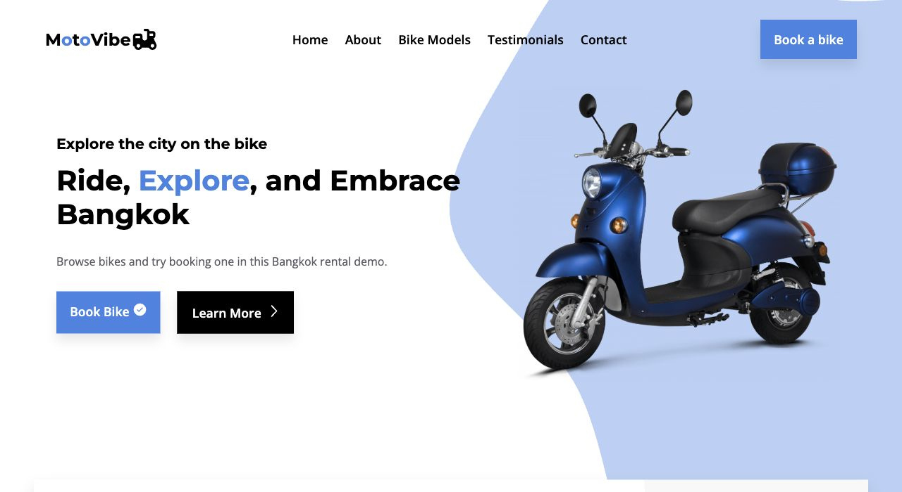
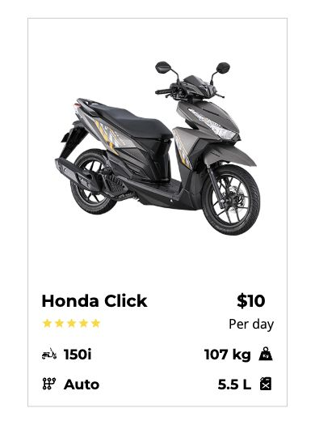

# Moto Vibe

[Open the live demo](https://moto-vibe.netlify.app/)

A React project for a fictional motorbike rental shop in Bangkok. Browse five bikes, compare their specs, and try the booking flow with sample details.



## What you can try

- Compare daily rates, weight, and fuel or battery capacity in the bike catalog.
- Pick a bike, locations, and dates to open the booking form. The form checks the rental dates and times, and you can close it with Escape.
- Try the sample contact and newsletter forms.

Moto Vibe has no backend. It does not save bookings, send messages or emails, or create subscriptions.

## Run it locally

With Node.js and npm installed, run:

```sh
git clone https://github.com/OnigiriKing/moto-vibe.git
cd moto-vibe
npm ci
npm start
```

Open [http://localhost:3000](http://localhost:3000). Run `npm run build` to create the production build.

Built with React, React Router, and Sass. If you edit the SCSS, regenerate the checked-in CSS with:

```sh
npx --yes sass@1.77.8 src/styles/style.scss src/dist/style.css
```

## Bike catalog on mobile


